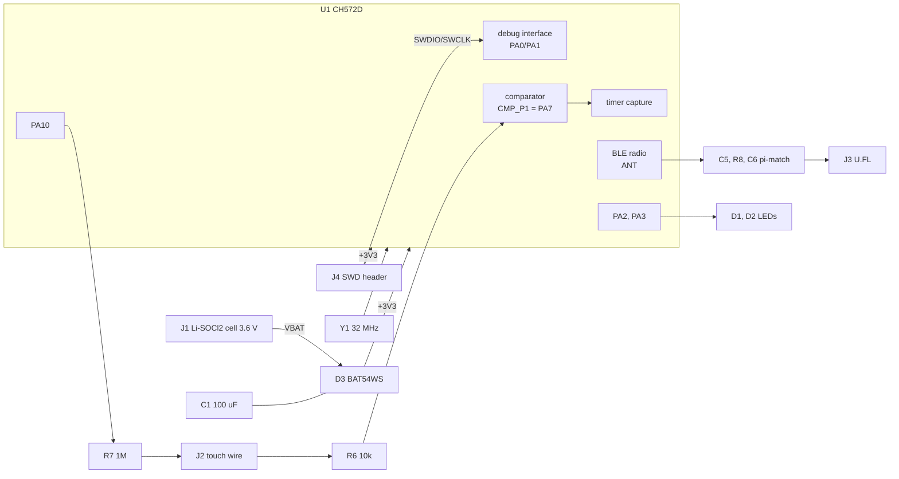
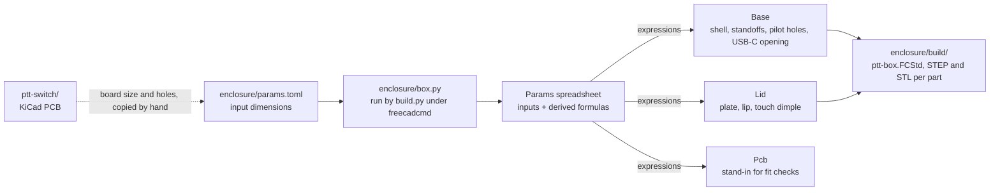
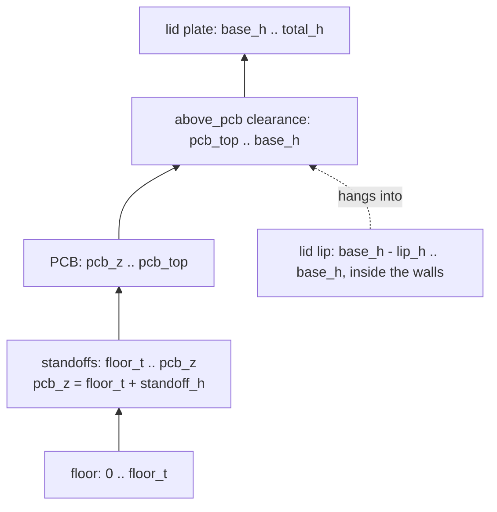
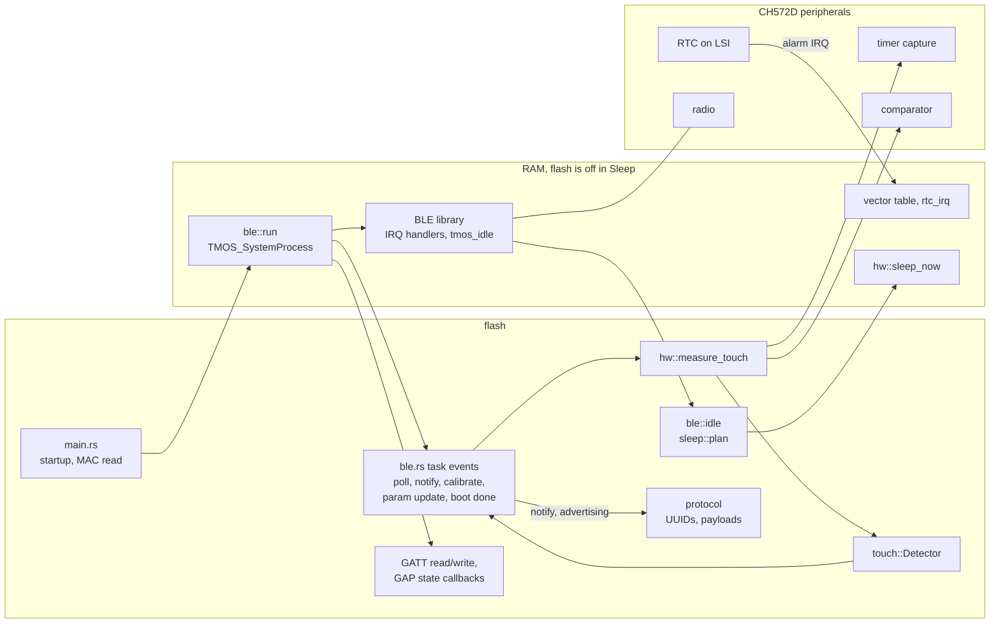
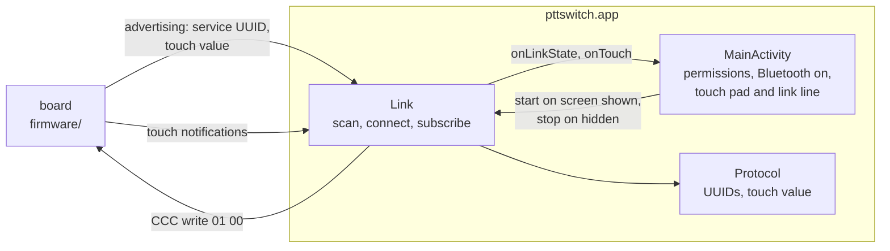
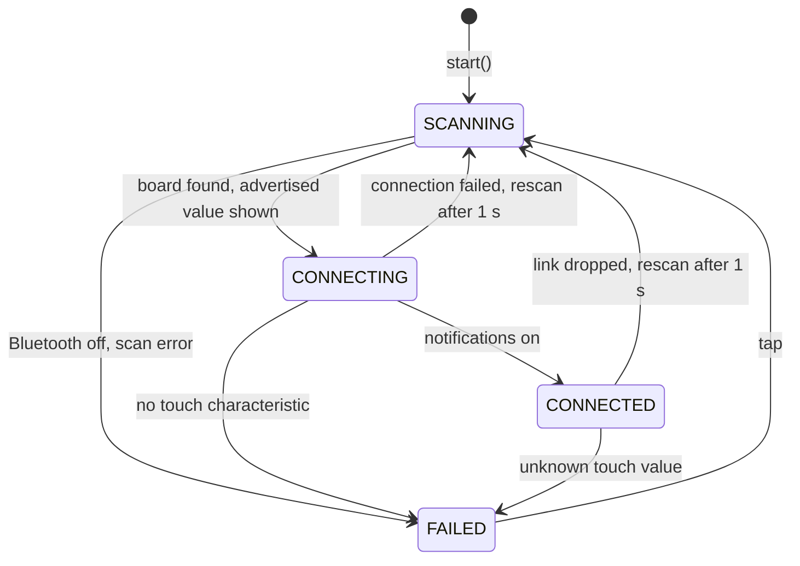

# Architecture

## Board

## One touch measurement, in order

Durations show order only, not time; the charge step is the measured one
(about 2.8 us at 10 pF, see [NOTES.md](NOTES.md)).

```mermaid
gantt
    dateFormat X
    axisFormat %s
    section PA10
    Low: discharge the wire through R7 :d1, 0, 5
    High: charge the wire through R7   :d2, after d1, 3
    section Comparator on PA7
    Below the reference                :c1, 0, 6
    Crosses the reference, output high :c2, after c1, 2
    section Timer
    Start at the PA10 rising edge      :t1, after d1, 1
    Capture on the comparator output   :t2, after c1, 1
```

## Enclosure build

## Enclosure section, bottom to top

Z = 0 is the underside of the floor; the PCB is centered on the Z axis.

## Firmware

One TMOS task (WCH's BLE scheduler) carries the firmware; the BLE
library's interrupts and the RTC wake-up feed it. Protocol:
[docs/BLE.md](docs/BLE.md).

## Not connected: one 200 ms cycle

The touch poll and the advertising event are separate wakes; each wake
starts 1.6 ms early for the crystal (`sleep::wake_lead`). Durations are
not to scale.

```mermaid
gantt
    dateFormat X
    axisFormat %s
    section Chip
    Sleep                      :s1, 0, 40
    Crystal restart            :w1, after s1, 3
    Touch poll                 :p1, after w1, 2
    Sleep                      :s2, after p1, 40
    Crystal restart            :w2, after s2, 3
    Advertising event          :a1, after w2, 4
    Sleep                      :s3, after a1, 40
    section RTC
    Alarm for the poll         :r1, 40, 1
    Alarm for the advertising  :r2, 85, 1
```

## Android app

`android/`, package `pttswitch.app`. Protocol: [docs/BLE.md](docs/BLE.md).

Link's states. Every state goes to OFF on `stop()`, when the screen is
hidden; tapping the pad in OFF or FAILED starts again.

